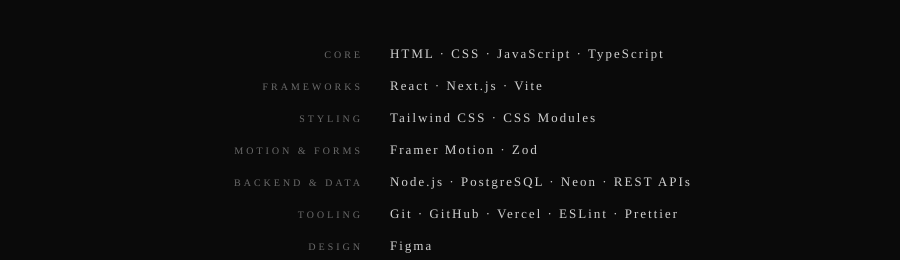

# b-1-o

### Erik G. · Frontend Developer · UI Engineer

React · TypeScript · Next.js · UI Engineering

  

&nbsp;&nbsp;

&nbsp;&nbsp;

&nbsp;&nbsp;

---

## About

I'm Erik — a frontend developer who enjoys turning complex layouts into clean, responsive interfaces, and finding elegant solutions for state, data flow and interactions along the way.

I work primarily with **React, TypeScript and Next.js**, with a focus on UI quality, responsive design, API integration and shipping real projects to production. I care about how things feel, not just how they look.

Currently open to **freelance work** and **frontend roles**.

---

## Technology Stack

